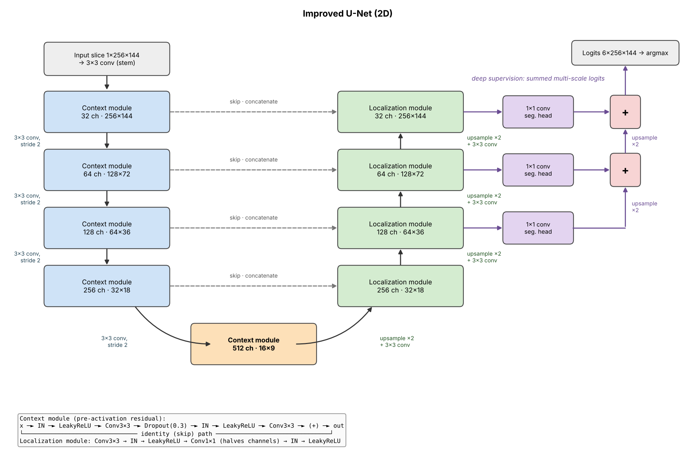
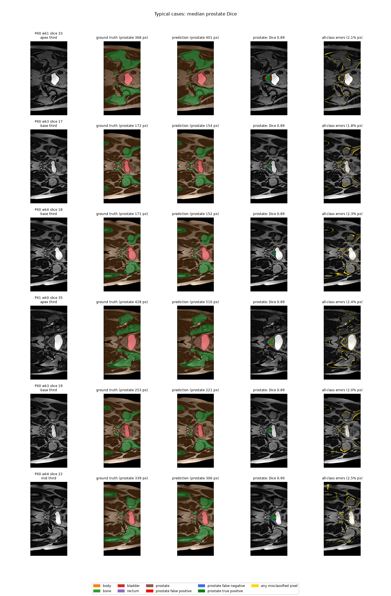
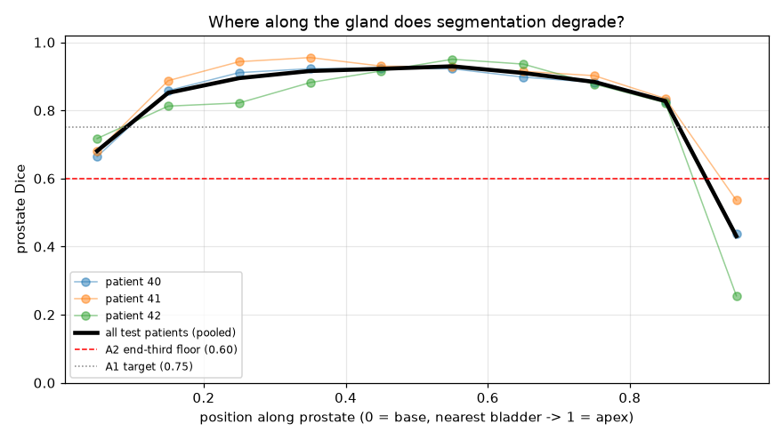
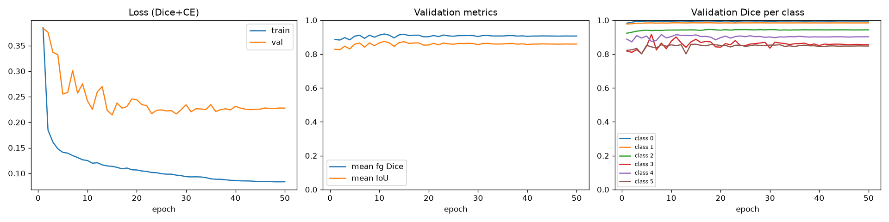
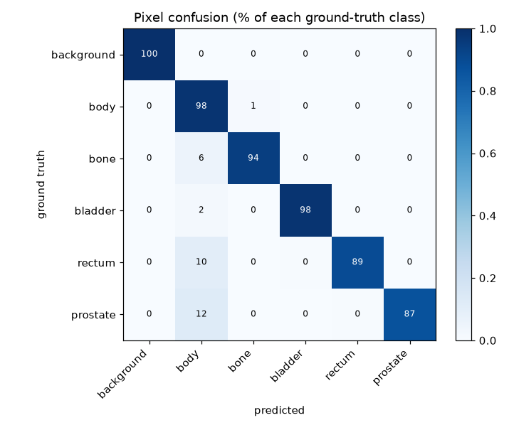

# Improved U-Net for Prostate MRI Segmentation (HipMRI)

## Overview

In prostate radiotherapy planning, the prostate and the surrounding organs at risk (bladder, rectum and bone) must be delineated on MRI with millimetre-level accuracy. Under-contouring the prostate risks tumour recurrence, while over-contouring irradiates healthy rectal and bladder wall and causes radiation toxicity. Manual delineation is slow, and an annotation assistant that proposes contours for a specialist to review and adjust could save considerable clinical time. This project builds the segmentation engine for such an assistant: a 2D convolutional network that assigns every pixel of a HipMRI pelvic MRI slice to one of six classes (background, body, bone, bladder, rectum, prostate). The task is hard for three reasons. The prostate is tiny (about 0.4% of all pixels in the training data), so a model can score well overall while barely segmenting it. Soft-tissue boundaries are low-contrast, and the thin interface between prostate, rectum and bladder is exactly where errors are clinically costly. And a good average Dice score can hide failures at the top (base) and bottom (apex) of the gland. We therefore implement the Improved U-Net, an extension of the original U-Net, and evaluate it against a standard 2D U-Net baseline, paying particular attention to where along the gland errors occur and not only to the global score.

## How it works

The network is an encoder–decoder with skip connections (see the figure below). A slice is z-score normalised, padded to a fixed 256×144 canvas and passed through a stem convolution. The encoder then halves the resolution four times with stride-2 convolutions, doubling the channels each time (32 → 512), and after each step applies a context module: a pre-activation residual block (instance normalisation → leaky ReLU → 3×3 conv, then dropout and a second normalisation → activation → conv, added back to its input). Putting normalisation and activation before the convolutions leaves the identity path untouched, which improves gradient flow, and instance normalisation keeps training stable with small batches. The decoder reverses the process: each level upsamples the coarser features, concatenates the encoder features from the same resolution (the skip connection, which restores the fine spatial detail lost by downsampling), and refines them in a localization module. In addition, the network uses deep supervision: 1×1 convolutions at the three finest decoder levels each produce a segmentation map, and these maps are upsampled and summed element-wise into the final prediction, so that earlier decoder layers receive a direct training signal. The model outputs six per-pixel scores, and the argmax gives the predicted label map. It is trained with a combined cross-entropy and soft-Dice loss (the Dice term counteracts the class imbalance, see below for the specific function), computed only over real, non-padded pixels. The 2D baseline uses the same data pipeline and loss, but plain double-convolution blocks with batch normalisation, no dropout and no deep supervision.

<p align="center">
  
</p>

<p align="center"><em>Figure 1. The 2D Improved U-Net. Blue: encoder context modules; green: decoder localization modules; dashed grey: skip connections; purple: deep-supervision heads whose upsampled outputs are summed into the final logits.</em></p>

### Loss function

Let $\Omega$ be the set of valid (non-padded) pixels in a batch, $p_{i,c}$ the softmax probability of class $c$ at pixel $i$, and $y_{i,c} \in \{0,1\}$ the one-hot ground truth. The model is trained with an equally weighted sum of cross-entropy and soft Dice loss:

$$
\mathcal{L} = \mathcal{L}_{\mathrm{CE}} + \mathcal{L}_{\mathrm{Dice}}
$$

$$
\mathcal{L}_{\mathrm{CE}} = -\frac{1}{|\Omega|} \sum_{i \in \Omega} \sum_{c=0}^{C-1} y_{i,c} \,\log p_{i,c}
$$

$$
\mathcal{L}_{\mathrm{Dice}} = 1 - \frac{1}{C-1} \sum_{c=1}^{C-1} \frac{2\sum_{i \in \Omega} p_{i,c}\, y_{i,c} + \varepsilon}{\sum_{i \in \Omega} p_{i,c} + \sum_{i \in \Omega} y_{i,c} + \varepsilon}
$$

where $C = 6$ is the number of classes and $\varepsilon = 1$ is a smoothing constant. The Dice term is computed per class over the whole batch (not per slice), which keeps it stable for classes that appear in only some slices, and it averages over the five foreground classes only, so the large background class does not dominate. Cross-entropy provides well-behaved gradients early in training, while the Dice term directly optimises overlap and counteracts the extreme class imbalance.

## Feasibility Report

Before any intensive training, a feasibility review was conducted and presented as a one page report. That report is presented here to archive this step of the
process and to define important acceptance criteria.

**1. User Need, Scope & Acceptance Criteria**\
**User and purpose.** The user is a radiation oncologist or imaging specialist who reviews and edits proposed contours on 2D pelvic MRI
slices. The prototype is a contour proposal tool, not an autonomous contourer. The open dilemma is that a good global Dice can hide failures
at the base and apex slices and leakage into the rectal wall or bladder. We therefore treat *where* errors occur as the primary outcome, and
global Dice as secondary. Scope: a 2D U-Net baseline on HipMRI, with upgrades to an Improved U-Net if the baseline passes and time allows.
All criteria are evaluated on a held-out, patient-level test split.


| ID | Testable acceptance criterion (test split, mean over patients) | Addresses |
| --- | --- | --- |
| **A1** | Prostate DSC $\ge 0.75$ (target 0.90 stretch); every other class $\ge 0.75$; per-class IoU reported. | Global accuracy |
| **A2** | Prostate DSC in the *base* and *apex* thirds of each patient's prostate extent $\ge 0.60$, with mid-gland minus worst-end gap $\le 0.15$. | Slice-transition failure |
| **A3** | Leakage: predicted prostate pixels lying inside GT rectum/bladder $\le 5\%$ of predicted prostate area. | Boundary leakage |
| **A4** | Resource: peak training VRAM $\le 8\text{ GB}$ (batch 16, AMP); inference $\le 50\text{ ms/slice}$; full training $\le 2\text{ GPU-h per run}$. | Operational budget |
| **A5** | Zero patient overlap between train/val/test (asserted in code). | Validity |

**2. Model Choice & Course Concepts**\
**Data.** HipMRI 2D slices (NIfTI, loaded with `nibabel`, Appendix B), with integer label maps one-hot encoded into $C$ channels (background,
body, bone, bladder, rectum, prostate). Intensities are z-scored per volume using the foreground mean/std, and the image and mask are never
resampled independently, so alignment is preserved. Splits are by patient ID, never by slice. **Model.** Baseline is the original U-Net
(Ronneberger et al., 2015): a 4-level encoder--decoder with skip connections, with "same" padding (so output matches input size) and
BatchNorm added. Base width is 32 or 64 filters (width is the main VRAM lever). Loss is cross-entropy plus soft Dice (Milletari et al., 2016),
which counters the extreme class imbalance (prostate $<0.5\%$ of pixels). Optimiser is Adam (lr $10^{-3}$, cosine decay) with light
augmentation (flips excluded, since left--right is anatomically meaningful; small affine and intensity jitter only). **Difficulty
band.** Easy (upgrading to Normal based on time constraints): 2D U-Net baseline, with a stretch goal of an Improved U-Net as described in
lecture material (dropout layers, residual blocks, etc). **Support.** Course material on CNNs, skip connections, class-imbalance losses and
segmentation metrics; Taha & Hanbury (2015) motivate boundary metrics (HD95) alongside overlap metrics, and Isensee et al. (nnU-Net, 2021)
show a well-configured U-Net is a strong baseline that many "advanced" variants fail to beat.

**3. Preliminary Feasibility Evidence**\
**Resource estimate.** A 64-filter, 4-level U-Net has $\approx 31$ M parameters ($\approx 124$ MB fp32). With gradients and Adam states,
training state is $\approx 0.5$ GB. Activation memory for a $256\times128$ slice is roughly 0.2 GB/slice in fp32 (feature-map count
summed over levels, including concatenations and saved BN/ReLU outputs), so batch 16 needs $\approx 3$ GB, and $\approx 4$ GB in total with CUDA
overhead. This is well inside A4's 8 GB budget, and AMP roughly halves activations. Halving the width to 32 filters cuts parameters about
$4\times$, giving a fallback if memory is tight.

**Data Audit**:

-   **Number of patients / slices.** 38 patients, 12,660 slices (train
    31 / 11,460; val 4 / 660; test 3 / 540). 60 slices per patient-week
    volume, weeks 0--7 (test has no week 6).
-   **Image size and spacing.** 256×128 (all val/test; most train) and
    256×144 (some train). Both are divisible by 16, so a 4-level U-Net
    works.
-   **Per-class pixel fraction.** Train: 17.3% / 67.5% / 12.5% / 1.9% /
    0.36% / 0.43%.
-   **Fraction of slices with no prostate.** Train: 36.9%.
-   **Image--mask shape and affine equality check (pass/fail).** Pass:
    11,460/11,460, 660/660 and 540/540 match on shape and affine; 0
    out-of-range labels; no patient overlap between the provided splits.

**4. Risks, Budget & Fallback**\
**Key risks.** (i) *Class imbalance:* the model collapses to background; mitigated by Dice loss and monitoring per-class DSC every epoch. (ii)
*Slice position unknown* in 2D data, which would block A2; mitigate by parsing filename indices or reconstructing volumes. (iii) *Small
cohort,* giving high variance across patients; report mean $\pm$ SD over 3 seeds and use patient-level bootstrap CIs. (iv) *Silent leakage:*
accidental slice-level splitting inflates scores; guarded by the A5 assertion. (v) *Label noise* at base/apex limits attainable DSC;
interpret A2 relative to the baseline, not to 1.0.\ **Budget & next step.** Total plan $\approx$ 10 GPU-hours on one
8--16 GB GPU: smoke test and audit 0.5 h; baseline $3$ seeds $\times$ 1.5 h $=$ 4.5 h; one upgrade ablation 3 h; evaluation and figures (GT /
prediction / FP--FN difference overlays) 1 h; contingency 1 h. **Next experiment:** full baseline training with per-class, per-position
(base/mid/apex) metrics. **Fallback:** if A4 is breached, drop to 32 filters, AMP and crop to the pelvic ROI; if prostate DSC $<0.75$, switch
to a Tversky/focal loss or a two-stage ROI crop; if CAN/3D is unaffordable, report the 2.5D variant as the volumetric-context proxy
and state the cost--benefit finding from A5 as the recommendation.

## Dependencies and Reproducibility

### Requirements

The code uses only four third-party packages (everything else is the Python standard library). `modules.py` depends on PyTorch alone; `dataset.py` additionally needs `nibabel` and `numpy` for reading the NIfTI slices, and `train.py` / `predict.py` need `matplotlib` for plots.

| Package | Version | Used by |
|---|---|---|
| Python | 3.11 | `modules.py`, `dataset.py`, `train.py`, `predict.py` |
| PyTorch | 2.15 | `modules.py`, `dataset.py`, `train.py`, `predict.py` |
| nibabel | 5.4 | `dataset.py` |
| NumPy | 2.4 | `dataset.py`, `predict.py` |
| Matplotlib | 3.11 | `train.py`, `predict.py` |


Results in this report were produced on a single GPU. The code also runs on CPU (it falls back automatically), which is useful for quick tests but far too slow for a full training run.

### Data layout

The dataset is not included in this repository. Place the six HipMRI folders directly under one root directory and pass it to every script with `--root`:

```
<root>/
├── keras_slices_train/          case_XXX_week_X_slice_XX.nii.gz   (11,460 slices)
├── keras_slices_seg_train/      seg_XXX_week_X_slice_XX.nii.gz
├── keras_slices_validate/       (660)        keras_slices_seg_validate/
└── keras_slices_test/           (540)        keras_slices_seg_test/
```

`dataset.py` pairs every image with its mask by (patient, week, slice) and raises an error if a folder is missing, so a wrong `--root` fails immediately and visibly. Before any training it also verifies that no patient appears in more than one split.

### Reproducing the results

Each model was trained with three seeds (0, 1, 2) and evaluated once on the test split with the checkpoint that scored best on validation. The commands below are the ones used; replace `<root>` with your data path.

```bash
# Baseline 2D U-Net (base width 64, batch norm)
python train.py --root <root> --model unet --seed 0 --out_dir runs/unet_s0 \
    --epochs 50 --batch_size 16 --patience 0

# Improved U-Net (base width 32, dropout 0.3)
python train.py --root <root> --model improved --amp_dtype bf16 --seed 0 --out_dir runs/improved_s0 \
    --epochs 50 --batch_size 16 --patience 0

# Evaluate the best checkpoint and produce the figures and metrics
python predict.py --root <root> --run_dir runs/improved_s0
```

All other hyperparameters are the defaults in `train.py`: AdamW, learning rate 1e-3 with cosine decay, weight decay 1e-5, gradient clipping at 1.0 and the loss described above. Every run writes `args.json` (the full resolved configuration, including defaults), `history.csv` (per-epoch losses and validation metrics), `best.pt` and `test_results.json` to its output folder, so a result can always be traced back to the exact settings that produced it. A single run takes roughly 20–30 minutes on an A100 with for the improved model.

## Examples Predictions and Visualisations

### Predictions

<p align="center">
  
</p>
<p align="center"><em>Figure 2. Predictions on test slices of median prostate Dice. Columns, left to right: input slice; ground-truth labels; predicted labels; prostate error overlay (green = true positive, red = false positive, blue = false negative); and every misclassified pixel (yellow). Row titles give the patient, week and slice number and the position of the slice along the gland.</em></p>

Test slices with a median Dice score on the prostate were chosen as typical examples. It can be seen that contour maps are very similar to the ground truth, with
slight pixel level errors occurring on class boundaries.

### Where along the gland the model fails

<p align="center">
  
</p>
<p align="center"><em>Figure 4. Prostate Dice as a function of position along the gland, from the base (0, nearest the bladder) to the apex (1), pooled over the test volumes, with one thin line per test patient.</em></p>

As predicted in the feasibility report, the predictions are best in the middle third slices of each patient since this is where the prostate is most visible. The model
does, however, still have surprisingly good performance in the base third and only falls off in the apex third where the prostate may take up only a few pixels.
Despite this, the Dice score in each section is still good enough to pass the A2 criterion.

### Training behaviour and class confusion

<p align="center">
  
</p>
<p align="center"><em>Figure 5. Training curves of the Improved U-Net (seed 0): training and validation loss (left), validation mean foreground Dice and IoU (centre), and validation Dice for each class (right).</em></p>

While the training loss continues to decrease over each epoch, validation loss finds its minimum rather early on. After ~15 epochs there are no more significant gains
to be made in validation performance suggesting and further training is just overfitting to the train set. While this does mean that the model has likely hit the limit
of its capabilities (more training time would likely not show any improvements), it is a benefit for more resource limited tasks. If training is too slow, 20 epochs
would likely perform just as well as 50.

<p align="center">
  
</p>
<p align="center"><em>Figure 6. Pixel confusion matrix on the test split. Each row shows how the pixels of one ground-truth class were classified, as a percentage of that class.</em></p>

## Pre-processing

All pre-processing is implemented in `dataset.py`.

- **Loading.** Each slice and its mask are read with `nibabel` and squeezed to a 2D array. Neither is resampled, reoriented or cropped, and no bias-field correction or histogram matching is applied. A data audit confirmed that every image and its mask have identical shape and affine, so they stay pixel-aligned throughout.
- **Intensity normalisation.** MRI intensities have no fixed physical scale, so they are not comparable across scans without normalisation (Nyúl and Udupa, 1999). Each slice is standardised independently with a z-score computed over its non-zero (foreground) pixels, `(x − mean) / (std + 1e-6)`, which stops the large empty background from distorting the statistics.
- **Label encoding.** Masks are rounded to integers and checked to lie in 0–5; an out-of-range label raises an error. They are kept as integer maps and converted to a one-hot, six-channel encoding when the Dice loss and the metrics are computed.
- **Fixed-size canvas.** The training split contains slices of both 256×128 and 256×144 pixels, while the validation and test splits are all 256×128. To batch them together, every slice is padded at the bottom and right to 256×144, with the slice's minimum intensity for the image and class 0 for the mask. A boolean `valid` mask marks the real pixels, and the loss and all metrics are computed only over them, so the padding never counts as background. Both sizes are divisible by 16, as the four downsampling steps require.
- **Patient-level splitting.** Slices from the same patient are highly correlated, so the data is split by patient. The provided train, validation and test folders (31, 4 and 3 patients) are checked for shared patients on every run, and if any overlap were found, the code would re-split by patient identifier.

